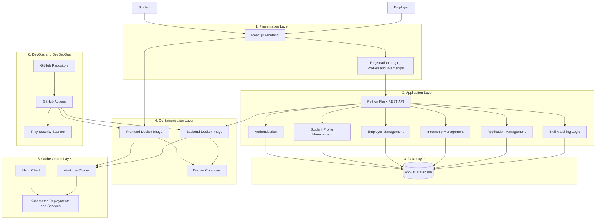

# 🎓 InternMatch
## Cloud-Native Internship & Skill Matching Platform

**React.js · Python Flask · MySQL · Docker · Kubernetes · Helm · GitHub Actions · Trivy**

---

# 📌 Project Overview

**InternMatch** is a cloud-native, full-stack web application developed to simplify internship discovery for students and improve candidate selection for employers. The platform provides a centralized environment where students can maintain their professional profiles, explore internship opportunities, and apply for positions that match their skills and qualifications.

Finding suitable internships can be challenging because opportunities are distributed across different platforms, and students often struggle to identify positions that align with their academic background, technical skills, certifications, and career interests. Similarly, employers must spend considerable time reviewing applications to identify candidates who meet their internship requirements.

InternMatch addresses these challenges by bringing students, employers, and internship opportunities together in a single application.

Students can register, log in, maintain their profiles, add their skills and qualifications, and browse available internships. Employers can create company profiles, publish internship openings, specify eligibility criteria, and review applications. The backend manages application operations and communicates with a MySQL database to store and retrieve information.

Beyond its application functionality, InternMatch demonstrates the use of modern cloud-native technologies. The frontend and backend are packaged into Docker containers, while Docker Compose supports local multi-container execution. Kubernetes provides the orchestration layer, Minikube enables local Kubernetes deployment, and Helm organizes deployment configurations into reusable charts.

The project also incorporates DevOps and DevSecOps practices through version control, automated validation, container image building, and vulnerability scanning.

### 🎯 Project Objectives

- Develop a centralized platform for internship discovery and application management.
- Enable students to maintain profiles containing academic information, skills, certifications, projects, and career preferences.
- Allow employers to create profiles and publish internship opportunities with specific eligibility requirements.
- Store student, employer, internship, and application information in a relational database.
- Implement backend APIs to support communication between the frontend and database.
- Containerize the frontend and backend using Docker.
- Use Kubernetes to deploy and manage application workloads.
- Use Helm charts to simplify Kubernetes configuration and deployment management.
- Incorporate CI/CD practices to reduce manual effort during application validation and release preparation.
- Introduce container security scanning to identify known vulnerabilities before deployment.

---

# 🏗️ System Architecture

InternMatch follows a layered architecture in which the frontend, backend, database, containerization tools, orchestration platform, and deployment automation work together.

## Architecture Diagram



*The diagram illustrates the intended architecture. The CI/CD stages and deployment integrations operate only when their corresponding configurations have been implemented.*

## Architecture Components

### 1. Presentation Layer — React.js

The frontend provides the user interface through which students and employers interact with InternMatch. It communicates with the Flask backend to submit information, retrieve internship listings, and perform supported operations.

The frontend is containerized separately so that it can be built and deployed independently of the backend.

### 2. Application Layer — Python Flask

The backend processes requests received from the frontend and implements the application's business logic. It handles supported operations involving authentication, student profiles, employer profiles, internships, applications, and matching.

Flask exposes API endpoints that allow the frontend to communicate with backend services without directly accessing the database.

### 3. Data Layer — MySQL

MySQL provides persistent relational storage for application information. The database contains the records required to support user accounts, profiles, internship listings, skills, and applications, according to the implemented schema.

The backend communicates with MySQL through its database integration layer.

### 4. Containerization Layer — Docker

Docker packages the frontend and backend with their required runtime environments. Separate Dockerfiles define how the respective application images are built.

Docker Compose coordinates the configured application containers and database service for local development and testing.

### 5. Orchestration Layer — Kubernetes and Minikube

Kubernetes manages the containerized application workloads through Deployments and Services. Deployments describe the desired state of application Pods, while Services provide stable networking and access to the relevant workloads.

Minikube provides a local Kubernetes cluster for development and demonstration.

### 6. Deployment Management — Helm

Helm organizes Kubernetes manifests into a chart containing metadata, configuration values, and templates. The InternMatch chart contains frontend and backend Deployment and Service templates, making deployment resources easier to manage as a group.

### 7. DevOps and DevSecOps — GitHub Actions and Trivy

GitHub provides version control hosting, while GitHub Actions can automate validation, testing, image building, and other configured workflow stages. Trivy can scan container images for known vulnerabilities.

The exact level of automation depends on the workflow configuration present in the repository.

---

# 🚀 Key Features

## 1. Student Registration and Profile Management

InternMatch provides student account and profile functionality.

Students can register and log in to access the platform. Their profiles can contain academic details, educational qualifications, skills, certifications, project information, and internship preferences.

Maintaining this information in one place helps students present their qualifications when exploring internship opportunities.

**Benefits:**
- Centralized student information.
- Easier access to internship opportunities.
- Organized academic and technical profile details.
- A foundation for matching students with relevant internships.

## 2. Employer and Company Management

Employers can use the platform to maintain company information and publish internship opportunities.

An employer profile can include the company name, description, website, industry, and location. This information helps organize internship listings by the organizations offering them.

The backend stores employer information and associates internship listings with the relevant employer.

**Benefits:**
- Centralized employer profiles.
- Structured internship listings.
- Easier management of internship information.
- Clear association between employers and their opportunities.

## 3. Internship Posting and Discovery

The platform allows employers to publish internship openings containing information such as the internship title, description, domain, location, duration, stipend, eligibility requirements, and application deadline.

Students can view available opportunities through the frontend and identify positions relevant to their interests.

The backend retrieves internship data from MySQL and supplies it to the frontend through the appropriate APIs.

**Benefits:**
- Centralized internship discovery.
- Structured internship information.
- Easier access to eligibility requirements.
- Reduced need to search across multiple disconnected sources.

## 4. Internship Application Management

InternMatch supports an application workflow connecting students and internship listings.

When a student applies for an internship, the backend records the application and associates it with the corresponding student profile and internship. Application records can also maintain status information and other supported application details.

The database schema can enforce uniqueness for a student–internship pair to prevent duplicate applications when that constraint is configured.

**Benefits:**
- Organized application records.
- Clear association between students and internships.
- Support for application status tracking.
- Improved management of student applications.

## 5. Skill-Based Internship Matching

The platform is designed to help students discover opportunities that align with their skills and qualifications.

The backend can compare the skills recorded in a student profile with the skills required by an internship. Matching logic can then use the overlap between those skills to calculate compatibility and support recommendations.

For example, if a student has Python, SQL, and Flask skills and an internship requires Python and SQL, the matching component can identify those shared skills.

The effectiveness of this feature depends on the matching algorithm and scoring logic implemented in the backend.

**Potential benefits:**
- More relevant internship discovery.
- Easier identification of skill gaps.
- Better visibility into compatibility with internship requirements.
- A foundation for future recommendation enhancements.

## 6. REST API-Based Communication

The frontend communicates with the backend through API requests. Flask processes these requests and returns the appropriate responses.

This separation allows frontend components and backend functionality to be developed and maintained independently.

It also allows backend endpoints to be tested separately using tools such as Postman.

## 7. Docker-Based Containerization

Docker packages the application components into separate container images.

The frontend image contains the environment required to build and serve the React application, while the backend image contains the Python runtime and required application dependencies.

This approach helps maintain consistent execution environments and simplifies application packaging.

## 8. Multi-Container Execution Using Docker Compose

Docker Compose defines how the frontend, backend, and database services run together during local development.

Instead of starting each component independently, a single Compose configuration can define the services, networking, environment variables, and persistent storage.

The following command builds the configured images and starts the application:

```bash
docker compose up --build
```

The command succeeds only when the required images can be downloaded or built and the services start correctly.

## 9. Kubernetes-Based Orchestration

Kubernetes provides a declarative mechanism for deploying the application components.

The InternMatch deployment includes frontend and backend workloads, along with Services that provide network access to those workloads.

Kubernetes helps manage the desired number of application replicas and supports deployment updates through its workload controllers.

Minikube makes these capabilities available in a local development environment.

## 10. Helm-Based Deployment Management

The InternMatch Helm chart groups the Kubernetes configuration into a reusable deployment package.

Its templates define the frontend and backend Deployments and Services. Chart metadata describes the package, while configuration values can be used to customize deployment parameters.

Helm helps reduce repetitive manifest management and provides a standard way to install and upgrade application releases.

The chart was validated using `helm lint .`, which completed without linting errors. A subsequent installation attempt encountered a resource ownership conflict with an existing backend Service, so successful installation of that release has not yet been confirmed.

## 11. CI/CD and Container Security

The project can use a CI/CD workflow to automate application checks and prepare container images.

A typical workflow includes:
- Triggering a workflow when code is pushed.
- Validating the application.
- Building frontend and backend container images.
- Scanning images with Trivy.
- Validating the Helm chart.
- Deploying to Kubernetes when the required deployment configuration and access are available.

Automating these activities helps identify errors earlier and makes deployment procedures more consistent.

Only the stages present in the actual workflow should be considered implemented.

---

# 🛠️ Technologies and Tools Used

| Technology | Role in InternMatch |
|---|---|
| **React.js** | Builds the interactive frontend used by students and employers. |
| **HTML5** | Defines the structure of the web interface. |
| **CSS3** | Provides page styling and layout. |
| **JavaScript** | Implements frontend interactions and API communication. |
| **Python** | Implements backend functionality and application logic. |
| **Flask** | Exposes REST API endpoints for frontend communication. |
| **Flask-JWT-Extended** | Supports token-based authentication when configured in the backend. |
| **Flask-SQLAlchemy** | Provides ORM-based database access. |
| **Alembic** | Supports database schema migrations. |
| **MySQL** | Stores structured application data. |
| **Docker** | Builds container images for the application components. |
| **Docker Compose** | Coordinates local frontend, backend, and database services. |
| **Kubernetes** | Orchestrates application workloads and networking. |
| **Minikube** | Runs a local Kubernetes cluster. |
| **Helm** | Packages and manages Kubernetes deployment resources. |
| **Git** | Tracks source-code changes. |
| **GitHub** | Hosts the repository and supports collaboration. |
| **GitHub Actions** | Automates configured CI/CD tasks. |
| **Trivy** | Scans supported artifacts, including container images, for vulnerabilities. |
| **Postman** | Tests backend API endpoints during development. |

---

# 📂 Repository Structure

The following structure reflects the known project components and Helm chart. Confirm the exact filenames against your local repository before using this as a definitive file inventory.

```text
cloud-native-internship-platform/
│
├── .github/
│   └── workflows/
│       └── ci.yml                     # CI/CD workflow, if configured
│
├── backend/
│   ├── app/
│   │   ├── auth/                      # Authentication endpoints
│   │   ├── students/                  # Student profile operations
│   │   ├── employers/                 # Employer profile operations
│   │   ├── internships/               # Internship management
│   │   ├── applications/              # Application management
│   │   └── matching/                  # Matching operations
│   │
│   ├── Dockerfile                     # Backend image definition
│   ├── requirements.txt               # Python dependencies
│   └── .env.example                   # Example environment variables
│
├── frontend/
│   ├── src/                           # React application source
│   ├── public/                        # Static frontend assets
│   ├── Dockerfile                     # Frontend image definition
│   └── package.json                  # JavaScript dependencies
│
├── mysql/
│   └── init.sql                       # Database initialization schema
│
├── internmatch/
│   ├── Chart.yaml                     # Helm chart metadata
│   ├── values.yaml                    # Configuration values, if present
│   └── templates/
│       ├── _helpers.tpl               # Reusable template helpers
│       ├── backend-deployment.yaml    # Backend Deployment
│       ├── backend-service.yaml       # Backend Service
│       ├── frontend-deployment.yaml   # Frontend Deployment
│       ├── frontend-service.yaml      # Frontend Service
│       ├── serviceaccount.yaml        # ServiceAccount configuration
│       ├── NOTES.txt                  # Helm installation notes
│       └── tests/                     # Chart tests, if present
│
├── docker-compose.yml                 # Local multi-container configuration
├── .dockerignore                      # Excludes files from Docker builds
├── .gitignore                         # Excludes selected files from Git
└── README.md                          # Project documentation
```

### Important Configuration Files

**`docker-compose.yml`**  
Defines the services required for local execution, including the application containers and database configuration.

**`backend/requirements.txt`**  
Lists the Python packages required by the Flask backend.

**`frontend/package.json`**  
Defines frontend dependencies and the available npm scripts.

**`backend/.env.example`**  
Provides an example of the environment configuration expected by the backend. Actual credentials should be supplied separately.

**`internmatch/Chart.yaml`**  
Contains the Helm chart name, version, and other chart metadata.

**`internmatch/templates/`**  
Contains the Kubernetes resource templates used by Helm to generate the frontend and backend deployment resources.

---

# ⚙️ Step-by-Step Execution Guide

## 1. Prerequisites

Ensure that the following tools are installed and configured:

- Python and pip.
- Node.js and npm.
- Docker Desktop.
- Git.
- Minikube.
- kubectl.
- Helm.

Docker Desktop should be running before executing Docker commands. A working network connection is also required when Docker needs to download base images that are not already available locally.

## 2. Clone the Repository

Open a terminal and execute:

```bash
git clone https://github.com/Dhishitha05/cloud-native-internship-platform.git
cd cloud-native-internship-platform
```

This downloads the project source code and moves the terminal into the repository directory.

If the repository has already been cloned, navigate directly to the existing project directory instead.

## 3. Configure the Backend

Navigate to the backend directory:

```bash
cd backend
```

Create a Python virtual environment:

```bash
python -m venv venv
```

Activate it on Windows:

```cmd
venv\Scripts\activate
```

Install the required Python packages:

```bash
pip install -r requirements.txt
```

Configure the environment variables required by the application before starting the backend.

Example database configuration:

```env
DB_HOST=localhost
DB_PORT=3306
DB_NAME=internship_platform
DB_USER=your_database_user
DB_PASSWORD=your_database_password
```

These are illustrative values. Use the variable names expected by your actual backend configuration.

When running inside Docker Compose, the database hostname generally needs to refer to the Compose database service rather than `localhost`.

**Security note:** Do not commit real database credentials, JWT secrets, or other sensitive environment variables to the repository.

## 4. Configure the Frontend

Open another terminal and navigate to the frontend directory:

```bash
cd frontend
```

Install the frontend dependencies:

```bash
npm install
```

Start the frontend using the development script defined in `package.json`:

```bash
npm start
```

If your project uses a different npm script, use the corresponding command defined in `package.json`.

The frontend must also be configured to communicate with the correct backend API address.

## 5. Run the Full Application Using Docker Compose

Return to the project root:

```cmd
cd C:\Users\Vamsi\Desktop\internship-platform
```

Build and start the configured services:

```bash
docker compose up --build
```

Docker Compose reads `docker-compose.yml`, builds the configured application images, and starts the services.

For the current local setup, the intended access points are:

| Component | URL |
|---|---|
| Frontend | http://localhost:8080 |
| Backend | http://localhost:5000 |
| Database connectivity test | http://localhost:5000/db-test |

The database test URL works only if the backend exposes that endpoint.

### Verify the Application

After startup:

1. Open the frontend URL.
2. Register a test student account.
3. Log in using the test account.
4. Verify that internship listings load.
5. Test employer functionality using an employer account.
6. Check that application data is stored and retrieved correctly.

The backend and database must be running for operations that require persistent data.

### Stop the Application

Press `Ctrl+C` in the terminal running Docker Compose.

To stop the services:

```bash
docker compose down
```

Do not use `docker compose down -v` unless you intentionally want to delete the associated volumes and potentially remove persisted database data.

### Troubleshooting Docker Image Downloads

If Docker reports an error such as:

```text
TLS handshake timeout
failed to resolve source metadata for docker.io/library/node:22-alpine
```

the problem may be a network connection failure while accessing Docker Hub.

Check the network connection and retry the required image download. If the current network continues to time out, testing with another reliable network may help.

Do not modify application code solely to resolve a Docker Hub connection timeout.

---

# 🐳 Containerization and Kubernetes Deployment

## 1. Docker Containerization

Docker is used to package the application components into container images.

The frontend Dockerfile defines the steps required to build the React application and prepare it for serving. The backend Dockerfile defines the Python environment, installs the required dependencies, and prepares the Flask application to run.

Using separate images allows the frontend and backend to be built and updated independently.

## 2. Docker Compose

Docker Compose is used for local multi-container execution.

The Compose configuration connects the frontend, backend, and database services according to the declared configuration. It can also define port mappings, environment variables, health checks, and persistent storage.

This simplifies development because the application components can be started together rather than configured individually.

## 3. Kubernetes with Minikube

Kubernetes manages containerized workloads through declarative resources.

The InternMatch chart contains separate frontend and backend Deployments and Services. A Deployment specifies the desired application Pods and supports controlled updates. A Service provides a stable network endpoint for accessing the relevant Pods.

Minikube runs a local Kubernetes cluster so that the application can be tested without requiring a remote cluster.

Start Minikube:

```bash
minikube start
```

Check the cluster:

```bash
kubectl get nodes
```

Check application resources:

```bash
kubectl get pods
kubectl get services
kubectl get deployments
```

These commands show the current Kubernetes resource state. A running Pod does not, by itself, guarantee that the application is reachable or functioning correctly.

## 4. Helm Chart Structure

The Helm chart is located in the `internmatch` directory.

```text
internmatch/
├── Chart.yaml
└── templates/
    ├── _helpers.tpl
    ├── backend-deployment.yaml
    ├── backend-service.yaml
    ├── frontend-deployment.yaml
    ├── frontend-service.yaml
    ├── serviceaccount.yaml
    ├── NOTES.txt
    └── tests/
```

A `values.yaml` file can provide default chart configuration. Confirm that it exists before listing it as a current file in the repository.

### Purpose of the Helm Files

**Chart.yaml:** Defines chart metadata, including the chart name and version.

**values.yaml:** When present, supplies configurable values that templates can use for image names, ports, replica counts, and other settings.

**backend-deployment.yaml:** Defines how Kubernetes should run the Flask backend Pods.

**backend-service.yaml:** Defines network access to the backend Pods.

**frontend-deployment.yaml:** Defines how Kubernetes should run the frontend Pods.

**frontend-service.yaml:** Defines how users or other components access the frontend Pods.

**_helpers.tpl:** Contains reusable Helm template helpers.

**NOTES.txt:** Provides information displayed after Helm installation or upgrade.

**serviceaccount.yaml:** Defines the ServiceAccount resource when it is included in the chart.

## 5. Validate the Helm Chart

Navigate to the chart directory:

```cmd
cd C:\Users\Vamsi\Desktop\internship-platform\internmatch
```

Validate the chart:

```bash
helm lint .
```

A successful result should indicate that the chart has been linted without errors.

Chart linting checks chart structure and common issues, but it does not guarantee that the application will deploy successfully.

## 6. Install the Helm Release

The standard installation command is:

```bash
helm install internmatch .
```

After installation, inspect the release:

```bash
helm list
```

Inspect the Kubernetes workloads:

```bash
kubectl get pods
kubectl get services
kubectl get deployments
```

### Existing Resource Ownership Conflict

During the current project setup, the installation attempt failed because the Service `internmatch-backend` already existed and did not have the ownership metadata required by Helm.

This means the resource already exists in Kubernetes but is not registered as belonging to the `internmatch` Helm release.

Do not delete unrelated workloads or apply ownership changes blindly. Inspect the existing resource and the chart configuration before choosing a safe resolution.

Once the conflict has been resolved, Helm can be used to manage the release and perform future upgrades.

## 7. Access the Frontend Through Minikube

Check the frontend Service:

```bash
kubectl get service internmatch-frontend
```

Request a Minikube access URL:

```bash
minikube service internmatch-frontend --url
```

Open the URL returned by Minikube in your browser.

If the command keeps running while providing the URL, leave the terminal open during testing when required by your Minikube driver.

If the website does not open, investigate the Service type, target port, Pod readiness, frontend configuration, and container logs.

---


## Pipeline Stages Explained

### 1. Source Code Management

Developers use Git to track code changes and GitHub to host the repository.

When a developer pushes changes, a configured GitHub Actions workflow can start automatically.

This provides a consistent starting point for validating code before preparing a new application version.

### 2. Application Validation

The workflow can execute relevant checks for both application layers.

For the frontend, this may include dependency installation, linting, and build verification. For the backend, it may include dependency installation, syntax checks, and automated tests.

These checks help detect problems before the application images are built.

### 3. Docker Image Build

After the configured validation steps pass, the workflow can build the frontend and backend Docker images.

Each image contains the application component and the runtime environment needed to execute it.

Building images in CI helps make the container build process repeatable.

### 4. Trivy Vulnerability Scanning

Trivy can scan the built images for known vulnerabilities in operating-system packages and application dependencies.

The scan results help developers identify outdated or vulnerable components and decide whether remediation is required.

A successful scan does not guarantee that an image is completely secure. Findings must be reviewed, and the pipeline must be configured to determine which findings should block a release.

### 5. Helm Chart Validation

The workflow can run Helm validation commands to identify problems in the chart.

For example:

```bash
helm lint ./internmatch
```

Additional rendering or Kubernetes validation checks can be included to identify configuration issues before deployment.

### 6. Deployment

After validation, a configured deployment stage can install or upgrade the application using Helm.

The target environment must be accessible to the pipeline, and the necessary authentication and deployment permissions must be configured.

For local Minikube deployment, additional configuration is required if the CI runner cannot access the local cluster.

---

# 🔐 Security Considerations

Security is important because InternMatch stores user information, manages authentication, and processes application data.

### 1. Credential Protection

Database passwords, JWT signing secrets, and other sensitive values should be supplied through environment variables or a suitable secrets-management mechanism.

Real credentials should never be committed to GitHub or embedded in public Docker images.

### 2. Authentication and Authorization

Authentication establishes the identity of a user. Authorization determines which operations that user is allowed to perform.

For example, student-only operations and employer-only operations should be protected by appropriate backend authorization checks.

### 3. Database Security

The database should only be accessible to the application components that require it. Database credentials should use appropriate permissions rather than unnecessary administrative privileges.

Input validation and parameterized database operations help reduce the risk of injection vulnerabilities.

### 4. Container Security

Docker images should use appropriate base images and avoid including unnecessary tools, development files, or secrets.

Trivy can help identify known vulnerabilities in image packages and application dependencies.

### 5. Kubernetes Security

Kubernetes resources should use appropriate permissions and network exposure.

Services should expose only the ports required for application access. Sensitive configuration should not be stored directly in public Helm values files.

---

# 🧪 Testing and Verification

Testing helps establish that the application behaves correctly at the functional, integration, and deployment levels.

| Test Category | Verification |
|---|---|
| Registration | A new user can create an account successfully. |
| Login | Valid credentials allow access to the appropriate account. |
| Student profiles | Profile information can be stored and retrieved. |
| Employer profiles | Employer information is saved correctly. |
| Internship management | Employers can create internship listings. |
| Internship discovery | Students can retrieve and view available listings. |
| Applications | Application records are stored correctly. |
| Database integration | The backend communicates successfully with MySQL. |
| Docker Compose | The configured services start and communicate. |
| Kubernetes | Pods become ready and Services route traffic correctly. |
| Helm | The chart passes linting and renders valid resources. |
| CI/CD | Configured workflow jobs execute successfully. |
| Security scanning | Trivy findings are reviewed and addressed appropriately. |

Testing should be performed against the actual running application. A successful Docker build, Helm lint, or running Pod alone does not prove that every application feature works correctly.

---


# 👩‍💻 Project Information

**Project Name:** Cloud-Native Internship & Skill Matching Platform  
**Application Name:** InternMatch  
**Domain:** Cloud-Native Application Development and Container Orchestration  
**Frontend:** React.js  
**Backend:** Python Flask  
**Database:** MySQL  
**Containerization:** Docker and Docker Compose  
**Orchestration:** Kubernetes and Minikube  
**Deployment Management:** Helm  
**DevOps:** Git and GitHub Actions  
**Security Scanning:** Trivy  

**GitHub Repository:**  
https://github.com/Dhishitha05/cloud-native-internship-platform

---

## Conclusion

InternMatch combines a full-stack internship management application with modern containerization and orchestration technologies. React.js provides the user interface, Flask implements backend APIs, and MySQL stores application data. Docker and Docker Compose support containerized local execution, while Kubernetes, Minikube, and Helm provide a framework for local cloud-native deployment.

The project also demonstrates how CI/CD automation and container vulnerability scanning can be incorporated into the software delivery lifecycle. Together, these technologies provide a practical demonstration of full-stack development, cloud-native deployment, and DevOps practices.
